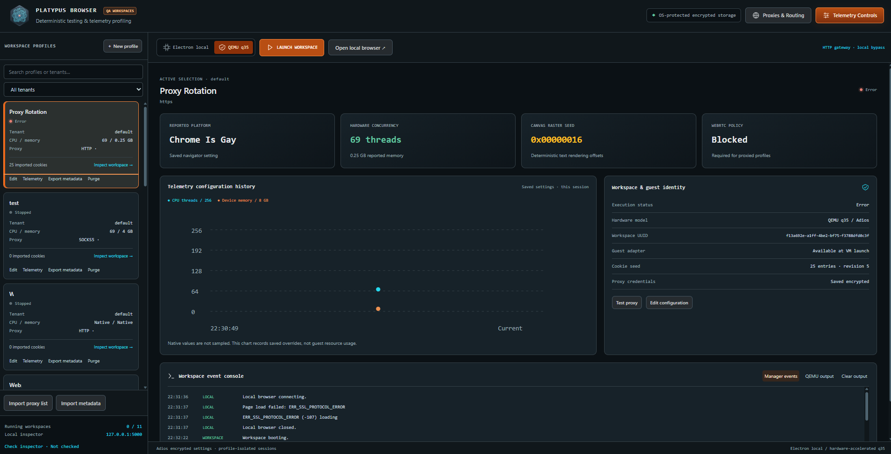

# Platypus Browser

Profile cards include a schema-driven **Telemetry** panel with native resets,
encrypted Adios settings/templates, presets and JSON import/export. See
[telemetry controls and runtime boundaries](docs/TELEMETRY.md).

Use Node.js 22 or newer. Install dependencies with `npm ci`; the Adios source package is included under `packages/adios`. Run `npm run dev` for development, `npm run typecheck` for TypeScript checks, and `npm run build` for a production build. These scripts rebuild Adios first; its core is bundled into the Electron main process.

**Launch Workspace** starts a QEMU q35 VM. Run `npm run guest:setup` to create and verify the included Debian/Chromium image and configure QEMU automatically; see the [guest image guide](docs/GUEST_IMAGE.md). Advanced host settings and recovery are covered in the [QEMU guide](docs/QEMU.md). **Open local browser** retains the host Electron browser. The generated guest image includes the adapter for the supplied runtime settings.

Run `npm run check` for the full automated suite, or `npm run test:qemu-real` for the hardware-accelerated QEMU smoke test.

Run `npm run test:runtime` for validation and integration checks in real Electron windows.

Enable **QA device simulation** when creating or editing a profile. Configure CPU threads (1–256), reported memory (0.25, 0.5, 1, 2, 4, or 8 GB), and a navigator platform string. Leave simulation disabled to use native properties. Existing profiles default to native behavior. Settings are validated in the main process and saved with the encrypted profile.

An optional unsigned 32-bit canvas seed applies repeatable offsets of at most 0.1 pixel per axis to 2D `fillText` and `strokeText`. Blank disables canvas changes; zero is a valid seed. Offsets affect drawing itself, so pixel readback and PNG/blob exports agree. Canvas state is restored after each call and native readback/security checks remain intact.

Electron uses a sandboxed, isolated preload with `contextBridge.executeInMainWorld` as its document-start equivalent of Playwright's `addInitScript`. Settings apply to the profile window's main document, including reloads and navigation, before application scripts execute. Manager and proxy-check windows are unaffected. Subframes, workers, OffscreenCanvas, WebGL, user-agent/client hints, actual CPU/memory resources, and OS behavior are not simulated. This is telemetry and rasterization testing, not full device emulation.

At startup, the app removes `enable-automation`, `test-type`, remote-debugging port/pipe, and Node inspect switches from Electron's command line. It does not attach a debugger or override `navigator.webdriver`. A debugger activated by the host before app startup cannot be undone by removing a switch; launch the app without external inspector options for a standard runtime.

## Proxy imports

Use **Import proxy list** and select your own private proxy list. No endpoints or credentials are included in this repository. Lines use
`host:port:username:password`; import creates one OS-encrypted profile per endpoint
and skips endpoints already saved. New profiles open Webshare's exit-IP page.
Existing profiles can use the same HTTP host, port and credentials through Edit.
Choose the protocol supplied by your provider; HTTPS proxy transport is a different protocol from HTTP.

Both **Launch Workspace** and **Open local browser** support these proxies.
VM launches use a dedicated gateway and block direct egress; no guest rebuild is
needed for the included Debian image. Other guest apps must use
`socks5h://127.0.0.1:1080`. HTTP proxy credentials travel unencrypted to the proxy;
HTTPS website content retains TLS encryption. Credentials are stored encrypted
and are not copied into guest files or process arguments. Keep the source list
private; it is excluded from Git.

Run `npm run test:proxy-guest -- "path/to/private-proxies.txt"` to verify the first
proxy in real concurrent guest browsers and check that direct egress is blocked.

## Cookie imports and local routing

Edit a saved, stopped profile and select **Import cookie profile**. JSON cookie
arrays, `{ "cookies": [...] }` exports and tab-delimited Netscape files are
supported, including `#HttpOnly_` records. Each import replaces the saved seed;
`[]` clears that seed without deleting existing browser cookies. Imports are
limited to 4 MiB / 3000 cookies. Expired cookies are skipped at startup.

Both browser paths hydrate before opening the requested page. Electron uses the
profile's persistent session and flushes its cookie store. The VM uses Chrome's
cookies API through its managed extension; imported values cross only the private
guest-agent channel and a temporary file in guest `/run`, removed after hydration.
Session cookies retain their original semantics and are rehydrated on the next
profile launch. Applying VM telemetry does not reapply the seed during that boot.
Existing browser cookies outside the imported keys remain intact.

`127.0.0.1`, `localhost`, `*.local` and IPv6 loopback bypass the external proxy by
default. Add exact hosts or `*.domain` patterns in **Additional proxy bypass hosts**.
Electron configures its session bypass list. In proxied VMs the host gateway handles
these exceptions directly, including host loopback diagnostics; all other traffic
still uses the upstream proxy. The guest Chromium environment sets both `no_proxy`
and `NO_PROXY` (with `.local` for suffix matching). Those variables do not configure
Electron networking by themselves. VM applications that connect directly to guest
localhost reach the guest; use its SOCKS gateway to reach host diagnostic routes.

Imported cookies and bypass settings are versioned together in the Adios encrypted
`session-vault`, with an OS-protected `keys/session-master.dat`. Back up both. Profile
lists expose cookie counts, revisions and rules, never cookie values. Profile purge
also deletes the encrypted session record. Cookie jars use Chromium's normal storage
protections; VM overlays are not independently encrypted.

See [session APIs and import formats](docs/SESSION_STATE.md).

## Tenant profiles and metadata transfer

Profiles now support Tenant IDs, mixed HTTP/HTTPS/SOCKS5 bulk imports (including
authenticated SOCKS5), and metadata-only import/export controls. Every profile keeps
its own browser partition, credentials and VM overlay. The shared main-process
proxy dispatcher maintains separate gateways and mandatory local routing exceptions.

Metadata clones create new workspace IDs and exclude cookie values and proxy
credentials. The local manager administers all tenants; tenant labels do not add a
remote authentication service. Hardware isolation continues to use QEMU q35 for
Adios SMBIOS compatibility.

See [workspace architecture and APIs](docs/WORKSPACE_ARCHITECTURE.md).

## Cockpit UI

The renderer now implements the enterprise cockpit layout with the application's
React bridge. Select a profile in the sidebar, choose Electron or QEMU q35, and
launch or stop its execution context. **Telemetry Controls** opens the existing
schema-driven editor, including templates, presets, JSON import/export and applying
to a running workspace. **Proxies & Routing** provides bulk imports, tenant selection,
local bypass configuration and JSON/Netscape cookie hydration.

Overview cards and the history chart display saved profile settings. The event
console shows actual lifecycle events and QEMU output; it does not simulate a Flask
log stream or guest CPU utilization. **Check inspector** makes a bounded, direct
HTTP probe to `127.0.0.1:5000` when clicked. Backend responses are reported as received.

The UI bundles its own styles, SVG icons and chart, so it needs no CDN scripts.
The original supplied mockup is preserved in
[the cockpit design reference](docs/ui/enterprise-cockpit.reference.html).
